# Exchange8:Regulatory

## 1. Summary

Exchange8:Regulatory is the **multi-jurisdiction regulatory reporting** service of
the exchange8 vertical: reportable order, trade and quote activity is
normalized into a single event shape, fanned out to every reporting
jurisdiction configured for the environment (IIROC/FIXROC, US Reg
NMS/Reg SHO/CAT, ESMA MiFIR, UK FCA, EMIR, Dodd-Frank), formatted per
regime by a pluggable reporter, and tracked end-to-end through its
acknowledgment lifecycle (`sent → acked | rejected | retrying | failed`)
under a dense, per-(environment, jurisdiction) report sequence. It is a Rust
axum binary built on the platform `sentin8::shell` crate (Sentin8 Shell):
self-registration, capped DB pool, health endpoint, Shield policy-admin

## 2. Motivation

- A single-regime stream cannot serve a venue operating under multiple rule
  books: IIROC order/trade/quote reporting (FIXROC), the US consolidated
  audit trail and short-sale regime, ESMA MiFIR RTS 22 transaction
  reporting, the UK FCA equivalent, and the derivatives regimes (EMIR,
  Dodd-Frank) disagree on which event classes are reportable and which
  fields are mandatory.
- **Format and transport are separable concerns.** Per-regime formatting
  belongs in pure, unit-testable code; the transport (FIX session, API, file
  drop, SFTP) is per-environment configuration, not a code path.
- **Acknowledgment is durable state, not memory.** Every formatted report is
  a row with an acknowledgment state, a sequence number and a retry count;
  regulator ACK/NACK and transport outages are reconciled against that row.
- **Sequence discipline is a regulator contract.** Reports are sequenced
  per (env, jurisdiction); gaps are legal (a rejection consumes a sequence),
  but a sequence is never reused - deduplication rides the
  `UNIQUE (env_id, jurisdiction, seq)` constraint.
- **Credentials are references, never plaintext.** Regime endpoint
  credentials live as `creds_secret_ref` values only.
- **Authorization is Shield, fail-closed.** The seeded scope-mirror set is
  the only gate; shadow mode is an emergency rollback lever, never a
  co-decision path.

## 3. Architecture & High-Level Design

The service is a Sentin8 Shell binary. The binary wires the HTTP/TLS surface
(health, `/openapi.json`, the Shield policy-admin API); the report fan-out
runs as a Bus consumer task in-process (the HTTP router carries health and
admin endpoints only). Domain logic lives in pure sibling modules the
consumer drives:

| Module | Responsibility |
|---|---|
| `regulatory.rs` | `Jurisdiction` (6 regimes, stable keys), `ReportClass`, the normalized `ReportableEvent`, the `Reporter` trait with one impl per regime, `ReportRouter` (fan-out, per-jurisdiction sequences, transport-down retry queue), `FormattedReport` |
| `registration.rs` | Self-registration: Shield scope-mirror policy set, PG role, admin scopes, error codes, RFW admin pages, M2M DCR grants, SQL init (schema bootstrap applied by `vertical enroll`) |

```mermaid
graph TD
    subgraph producers["Producers (exchange8 vertical)"]
        ME["Exchange8:ME (order events)"]
        OMS["Exchange8:OMS (order lifecycle)"]
        CLEARING["Exchange8:Clearing (trades)"]
        MD["Exchange8:MD (quotes)"]
    end

    subgraph svc["exchange8-regulatory binary (axum on sentin8::shell)"]
        ROUTER["HTTP router: GET /v1/health, /openapi.json, Shield policy-admin"]
        CONS["Bus consumer (reporter driver)"]
        CORE["ReportRouter + Reporter impls (6 regimes)"]
        SESSIONS[("regulatory.regulatory_session")]
        REPORTS[("regulatory.regulatory_report")]
        OUTX[("regulatory.outbox")]
        AUR[("regulatory.audit_journal")]
    end

    subgraph ext["Trust boundary: regulators"]
        FIXROC["IIROC FIXROC (FIX session)"]
        CATR["US CAT (API)"]
        MIFIRR["ESMA MiFIR RTS 22 (API)"]
        FCAR["UK FCA portal (API)"]
        EMIRR["EMIR RTS 1/2 (XML / API)"]
        DFOTC["CFTC Part 43/45 (API)"]
    end

    subgraph platform["Sentin8 platform"]
        SHELLQ["sentin8::shell: pool, relay, journal pusher, drain"]
        AUTH["Sentin8:Auth (issuer, M2M DCR)"]
        BUSR["Sentin8:Bus POST /v1/produce"]
        SYSR["Sentin8:Sys POST /v1/audit"]
        SHIELDX["Shield (sentin8-policy)"]
        PROXYX["Sentin8:Proxy (single ingress)"]
    end

    PGC[("PostgreSQL 18, db exchange8, schema regulatory, role exchange8_regulatory_service")]

    ME -->|"order events"| CONS
    OMS -->|"order events"| CONS
    CLEARING -->|"trade events"| CONS
    MD -->|"quote events"| CONS
    CONS -->|"normalized events"| CORE
    CORE -->|"FormattedReport per jurisdiction"| REPORTS
    CORE -->|"rows"| SESSIONS
    ROUTER -->|"evaluate (step 5)"| SHIELDX
    CONS -->|"domain write + outbox row, same tx"| OUTX
    SHELLQ -->|"relay (sentin8:bus:produce)"| BUSR
    SHELLQ -->|"journal push (sentin8:sys:audit:write)"| SYSR
    CORE -->|"reports, protocol per regime"| FIXROC
    CORE --> CATR
    CORE --> MIFIRR
    CORE --> FCAR
    CORE --> EMIRR
    CORE --> DFOTC
    ROUTER --> SHELLQ
    SHELLQ --> PGC
    PROXYX -->|"SNI exchange8-regulatory.<env>.<org>"| ROUTER
```

Persistence follows the platform DBX pattern: every domain write inserts a
`regulatory.outbox` row in the same transaction; the shell relay pushes it to
Sentin8:Bus `POST /v1/produce` (`idempotency_key` = outbox row id), and the
audit pusher drains `regulatory.audit_journal` to Sentin8:Sys
`POST /v1/audit` (`sentin8:sys:audit:write`).

## 4. Key Traits and Data Structures

Concepts, not signatures:

- **Jurisdiction** - the six reporting regimes, each with a stable wire key
  (`iiroc`, `cat`, `mifir`, `fca`, `emir`, `dodd_frank`) used in
  configuration rows (`regulatory_session.jurisdiction` CHECK) and event
  routing.
- **Report class** - the five event classes a venue can report: `new`,
  `modify`, `cancel`, `trade`, `quote` (mirrors the
  `regulatory_report.report_class` CHECK).
- **Reportable event** - the single normalized input shape both classes and
  regimes agree on: instrument, account, quantity, raw price, timestamp,
  side, short-sale flag, cross-book flag.
- **`Reporter` trait** - the regime boundary: one implementation per
  jurisdiction that formats an event at a caller-supplied per-session
  sequence. Field-selection rules per regime: IIROC formats every class;
  the US CAT reporter rejects quotes (quotes are not CAT obligations);
  the MiFIR, FCA, EMIR and Dodd-Frank reporters take trades only (order
  events and quotes are transaction-reporting out of scope there).
- **FormattedReport** - the per-regime output: jurisdiction, normalized
  payload string, regime sequence number. The shell converts payloads to the
  transport's wire form at the boundary (IIROC payloads carry the FIX 5.0
  tag selection: D new, G modify, F cancel, 8 execution).
- **ReportRouter** - the fan-out core: registers one reporter per
  jurisdiction, routes every event to all of them, keeps an isolated
  sequence counter per jurisdiction, and stashes formatted payloads in a
  retry queue when the transport is down. Rejections (class not reportable
  in that regime) return errors without queueing.
- **Report lifecycle (`ack_state`)** - `sent → acked | rejected |
  retrying`, with `retrying → sent` on recovery and `retrying → failed`
  when attempts exhaust; `retry_count` is the durable attempt tally.
- **Reporter configuration** - `regulatory_session` rows per environment:
  jurisdiction (unique per env), format (`fix`/`api`/`file`/`sftp`),
  transport, address/port, credentials as secret reference, enabled flag.

## 5. Rationale, Trade-offs, and Alternatives

- **Pluggable reporter layer instead of per-regime code across the venue.**
  One core owns normalization and fan-out; each regime is a self-contained
  formatter. Embedding reporters in clearing/me/OMS was rejected: it would
  fragment sequence discipline and acknowledgment tracking across services.
- **Dynamic dispatch (`Box<dyn Reporter>`) over static dispatch.** The
  registered regime set is runtime configuration per environment; static
  generics would recompile the fleet to enable a regime. Message rates are
  far below dispatch-overhead relevance; object safety is trivially met.
- **Normalized JSON payloads in the core; wire conversion at the
  transport.** Keeps the core pure and lets tests assert on field selection
  without FIX/SFTP parsers. Rejected alternative: regime-native structs in
  the core - that couples the pure core to wire formats and duplicates
  conversions.
- **Rejection consumes a sequence number.** A rejected event's sequence
  shows as a gap to the regulator; re-using it would violate FIX sequence
  semantics. Alternative (only format accepted events) would desynchronize
  the venue's own reconciliation from the regulator's view.
- **Global transport flag + per-jurisdiction queues.** The router models a
  single transport-up/down decision per routing pass; every registered
  reporter stashes exactly one retry entry per down event. Per-reporter
  transports with independent outage states were rejected as premature -
  a jurisdiction is enabled per environment, and a down regime endpoint is
  an environmental condition.
- **Durable state in `regulatory_report`, queue as backstop.** The pure
  core's retry queue is volatile by design; the durable truth is the report
  row in `retrying` state plus the outbox relay - recovery re-enters the
  same idempotent path.
- **Scope-mirror enforced, fail-closed.** No-set → deny; M2M token type
  never bypasses policy; forbid beats permit; tenant sets add role-keyed
  grants through the same engine (see `DESIGN.md` §5).
- **Secrets by reference.** `regulatory_session.creds_secret_ref` is the
  only credential surface; plaintext regime credentials would violate the
  platform secret-reference rule.

## 6. Internal Implementation & Invariants (Private Design)

- **Sequence isolation.** Each jurisdiction's counter starts at 1 and
  advances per format attempt on that jurisdiction's reporter alone; a
  second jurisdiction never observes another's counter.
- **Ordering of consumed sequences.** A format rejection increments the
  counter (the gap is the record) and consumes no retry entry; a
  transport-down report increments the counter AND stashes
  `(jurisdiction, payload)` in the retry queue with fresh formatting on
  retry (never the stashed stale sequence).
- **Retry draining.** One `retry()` call drains the whole accumulated
  queue; entries are in registration order per batch, and repeated
  transport-down batches accumulate (the durable layer deduplicates via
  `UNIQUE (env_id, jurisdiction, seq)` and outbox `idempotency_key`).
- **All-or-nothing reads.** `regulatory_report` carries `UNIQUE
  (env_id, jurisdiction, seq)` and an index on `(env_id, ack_state)` for
  the reconciliation sweep; a replayed report cannot double-exist.
- **RLS parity.** All four tables (`regulatory_session`,
  `regulatory_report`, `regulatory.outbox`, `regulatory.audit_journal`)
  are `ENABLE` + `FORCE ROW LEVEL SECURITY` with the standard context
  policies; the service role holds no `BYPASSRLS` and no cross-schema
  grants; the outbox trigger notifies `regulatory_outbox_changed` and the
  partial indexes bound the relay scan (`relayed = false`) and the audit
  push scan (`pushed = false`).
- **Registration truth.** The declared Shield text (`SCOPE_MIRROR_POLICIES`)
  is the single source for the scope-mirror set; the policy wiring tests
  assert against that exact string and the enroll dry-run gate must pass.
- **Wire keys are frozen.** Jurisdiction keys and report-class names match
  the SQL CHECKs exactly; a mismatch would silently disable a regime.

## 7. Unresolved Questions / Future Designs

- The HTTP surface carries health, `/openapi.json` and the Shield
  policy-admin API; the RFW admin pages declared in registration
  (`sessions` - Reporters, `reports` - Report History) do not yet have
  mounted data/UI handlers in this binary.
- Regime transports (FIX session management, API clients, file/SFTP drops)
  are configuration surfaces (`regulatory_session.format`,
  `address`, `port`, `creds_secret_ref`) without in-tree transport
  adapters yet.
- Report persistence, outbox emission and acknowledgment ingestion (the
  writer surfaces feeding `regulatory_report` and `regulatory.outbox`) are
  designed but not wired in this unit; `event_triggers` in registration is
  empty.
- MiCA and MAR regimes appear in the vertical design but have no
  `Jurisdiction` variant yet (the enum and the SQL CHECK carry six regimes).
- See `DESIGN.md` §10 for the full list.

---

**Design attribution:** exchange8:regulatory and its underlying concepts were designed by Hamid Jahanzad <Hamid@Jahanzad.com>.
